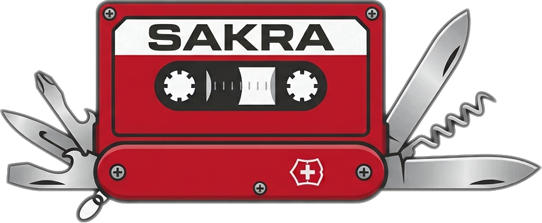
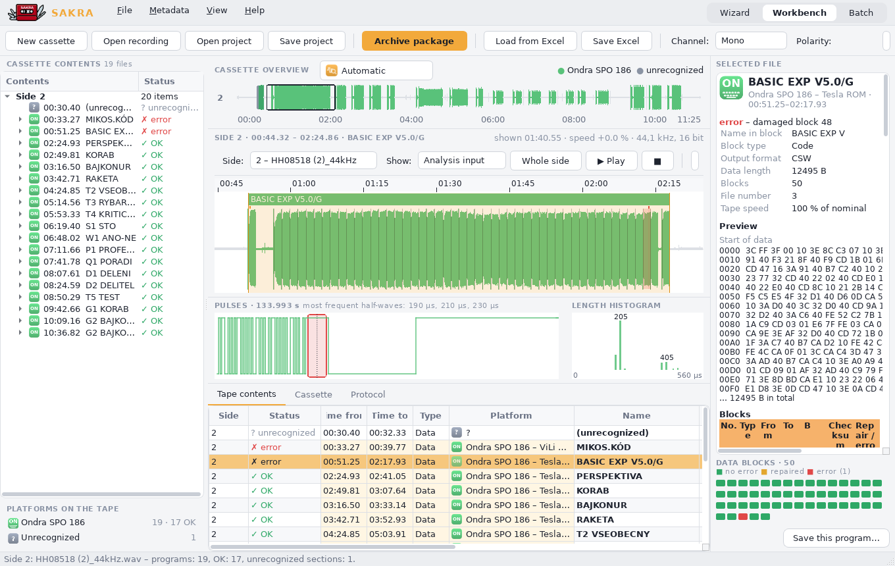
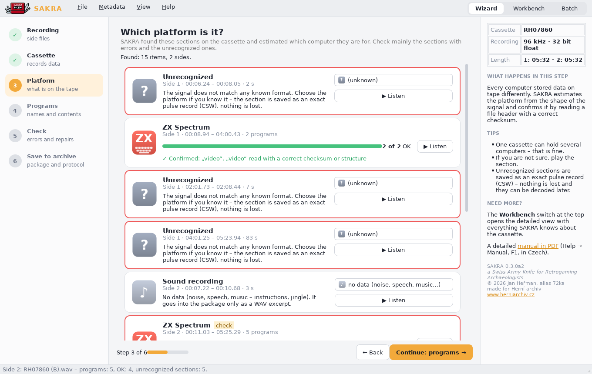
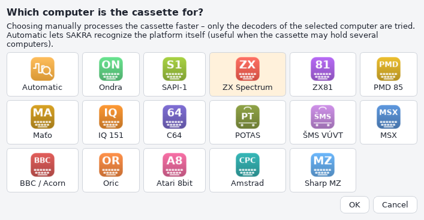
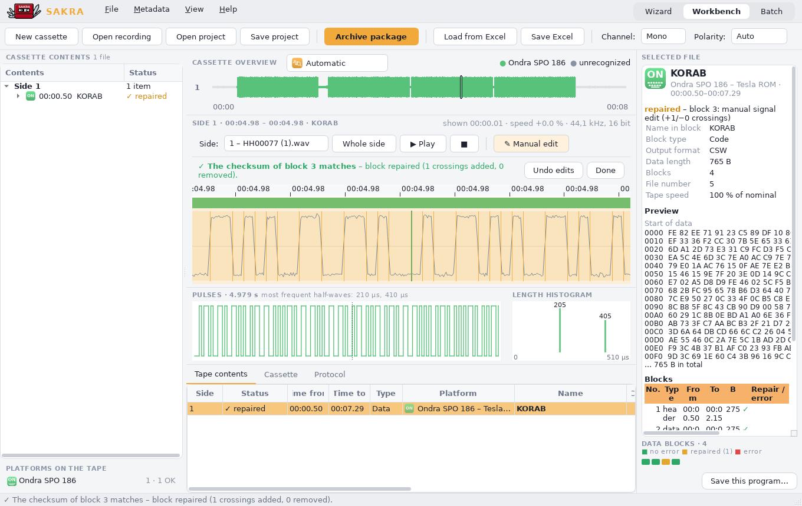
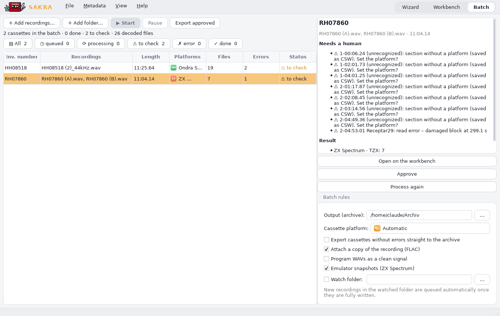
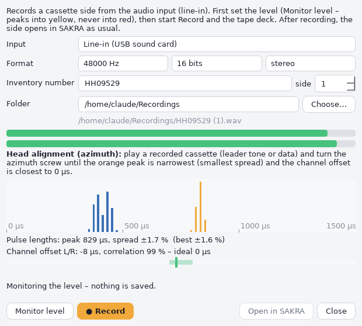
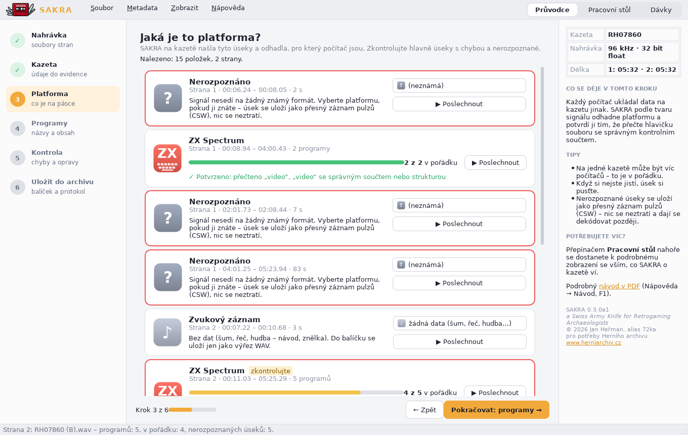

# SAKRA - a Swiss Army Knife for Retrogaming Archaeologists

<p align="center">
  
</p>

<p align="center">
  <a href="https://github.com/72ka/SAKRA/actions/workflows/sestaveni.yml"></a>
  <a href="https://github.com/72ka/SAKRA/releases"></a>
</p>

**Download:** ready-made builds for **Windows** (installer or portable zip) and **Linux** are on the
[Releases](https://github.com/72ka/SAKRA/releases) page – no Python needed.

**SAKRA** is a toolkit for retro-computing archaeology, data preservation and digital archiving. It turns digitized
audio recordings of old computer cassettes (`.wav`, `.flac`) into clean, emulator-ready tape images and binaries,
verifies them, repairs damaged blocks where possible, and packs everything into an archive package with metadata.

Author: **Jan Heřman (72ka)**, 2025–2026. Made for the needs of the Czech game archive
**[Herní archiv](https://www.herniarchiv.cz)**.

The repository contains two things:

| Part | What it is |
|---|---|
| **SAKRA application** (`sakra/`) | Desktop application (Python, PySide6) and command line tool: analysis of whole cassette sides, platform detection, decoding, repair, metadata and archive packages. |
| **Obsolete stand-alone converters** (`obsolete/`) | Original single-platform command line converters, superseded by the application. They still work on their own and served as the verified reference for its decoders. |

---

## Screenshots

**Workbench** – cassette overview, waveform of the side, pulses and length histogram, tape contents table and the
selected program with its data blocks (green = OK, red = damaged).



<table>
<tr>
<td width="50%"><br>
<b>Wizard</b> – six steps for volunteers. SAKRA shows which computers it found on the tape and confirms them
with checksums; unrecognized sections can be played back and assigned by hand.</td>
<td width="50%"><br>
<b>Which computer is the cassette for?</b> – choose it (only its decoders run, faster) or let SAKRA recognize
it automatically. Every platform has its own icon.</td>
</tr>
<tr>
<td width="50%"><br>
<b>Manual repair</b> – zoom in to single samples and add or remove a zero crossing; the block is decoded again
at once and SAKRA tells when its checksum matches.</td>
<td width="50%"><br>
<b>Batch</b> – a queue of cassettes processed in the background; error-free ones go straight to the archive,
the rest wait for a human check.</td>
</tr>
<tr>
<td width="50%"><br>
<b>Record from tape – head alignment</b>: a misaligned head shifts the stereo channels (here over 100 µs,
red) and widens the pulse-length peak.</td>
<td width="50%"><br>
<b>After turning the azimuth screw</b>: channel offset within the green zone, a narrower orange peak and a
smaller spread – ready to record.</td>
</tr>
</table>

The interface is available in **English and Czech**; the screenshots above are from the English version.

---

## SAKRA application

### Supported platforms

| Platform | Output |
|---|---|
| Ondra SPO 186 – Tesla ROM (MIKOS) | CSW + BIN |
| Ondra SPO 186 – ViLi ROM | TAP (JOndra) + BIN |
| SAPI-1 – MIKOS | CSW + TXT / BIN |
| PMD 85, Didaktik Alfa, Consul 2717 | PTP (incl. non-standard blocks) + BIN |
| Maťo | PTP with PMD 85 header + BIN |
| IQ 151 (standard and Komenium) | Intel HEX |
| ZX Spectrum (standard and turbo) | TZX / TAP, loading screen and screen after start (built-in emulator) |
| ZX81 (ROM and FASTSAVER) | P |
| Commodore 64 / VIC-20 | TAP v1 + PRG |
| MSX | CAS |
| BBC Micro / Acorn Electron | UEF + BIN |
| Atari 8-bit (standard and Turbo 2000) | CAS + XEX/BAS/BIN |
| Amstrad CPC | CDT + BIN |
| Sharp MZ-700/800 | MZF |
| Oric | TAP |
| Sord m5 | CAS (SORDM5) + BIN |
| POTAS (Czechoslovak army computer) | BIN + TXT (EDIS texts, BASIC listings) |
| ŠMS VÚVT Žilina (Kansas City 300 Bd) | BIN |
| unrecognized sections | CSW (exact pulses) + WAV excerpt; platform can be set by hand |

### Features

* Whole cassette side in one go: finds programs, recognizes the platform, decodes and checks checksums.
* Choose the computer the cassette is for (or *Automatic*): a manual choice runs only that computer's
  decoders and processes the cassette faster. Every platform has its own generated icon across the application.
* Repairs: re-reading of damaged blocks with an adaptive baseline, repair from another copy on the same tape,
  majority vote across copies, manual signal editing down to single samples.
* Record a cassette side straight from the audio input (*File → Record from tape…*): level meter with clip
  warning, head azimuth alignment aid (pulse-length histogram with peak spread, L/R channel offset in µs),
  files named `<inventory number> (<side>).wav`, then processed as usual.
* Settings: default workstation profile pre-filled into every new cassette, profile management with JSON
  import/export, configurable folders, settings stored in the system, a custom INI file or a portable
  `sakra.ini` next to the program (or `SAKRA_NASTAVENI`), full settings export/import.
* Stereo recordings: view left, right, both tracks or their sum; analyse the L+R sum aligned by the measured
  (or manually tuned) offset between tracks – helps with skewed heads and weak recordings.
* Cassette and case photos from files or straight from a connected USB camera (optional OpenCV add-on,
  `pip install -e ".[kamera]"`).
* Manual marking of noise, music and speech: Shift + drag on the timeline, right click → *Mark as*.
  The section gets its own row (Audio), and analysis skips it from then on (also after re-analysis;
  saved with the project).
* Weak-signal markers on the timeline: places where the level inside a block drops against its surroundings
  (orange = weak read below 50 %, red = dropout below 25 %), so damaged spots are easy to find.
* Three working modes: **Wizard** for volunteers, **Workbench** (waveform, pulses, length histogram, block map)
  and **Batch** processing with a watched folder.
* Metadata exactly in the layout of the Herní archiv spreadsheet (Excel import/export), archive package with
  FLAC copy of the recording, files of all programs, HTML/PDF protocol and SHA1SUMS. The wizard packs the package into a
  single `.7z` file by default (LZMA2).
* User interface in **English and Czech** (*File → Settings…*, follows the system language by default);
  archive outputs (Excel template, protocol) stay in Czech as required by Herní archiv.
* PDF manual in Czech (`sakra/dokumenty/SAKRA-navod.pdf`, also *Help → Manual*, F1).

### Running

Requires **Python 3.11+**.

* **Windows:** double-click `run.bat`.
* **Linux (Debian/Ubuntu):** install the Qt system libraries first:
  ```bash
  sudo apt install python3 python3-venv libgl1 libegl1 libxkbcommon-x11-0 \
      libxcb-cursor0 libxcb-icccm4 libxcb-keysyms1 libxcb-shape0 libfontconfig1 alsa-utils
  ./run.sh
  ```
  The first start creates `.venv` and downloads the dependencies (about 100 MB).
* **With [uv](https://docs.astral.sh/uv/):**
  ```bash
  uv sync
  uv run sakra                                              # GUI
  uv run sakra analyzuj "HH08518 (2).wav" --vystup archiv   # command line
  uv run sakra analyzuj "HH08518 (2).wav" --platforma "Ondra SPO 186"   # only Ondra decoders, faster
  ```

Note: PySide6 6.12.0 crashes on Python 3.11, so `pyproject.toml` pins PySide6 < 6.12 for Python 3.11.

### Stand-alone builds (no Python needed)

Builds are made automatically by **GitHub Actions** ([`.github/workflows/sestaveni.yml`](.github/workflows/sestaveni.yml)):

* every push runs the tests on Linux and Windows;
* pushing a version tag builds everything and publishes a release with the files:
  ```bash
  git tag v0.3.0a2 && git push origin v0.3.0a2
  ```
  (alpha/beta/rc versions are marked as pre-releases; set the same version in `sakra/__init__.py` and `pyproject.toml` first);
* *Actions → Sestavení → Run workflow* builds on demand (files are attached to the run as artifacts).

Local builds:

* Windows: `instalator\sestav_windows.bat` → `dist\SAKRA\`; with Inno Setup 6 installed also an installer.
* Linux: `instalator/sestav_linux.sh` → `dist/SAKRA/`.

### Tests

```bash
python -m unittest discover -s testy -t .
```

Tests use synthetic recordings of all platforms. Tests with real cassette recordings are skipped automatically
when the recordings are not present (they are not part of the repository because of their size).

---

## Obsolete stand-alone converters

The original converters are kept in [`obsolete/`](obsolete/). Their functionality is now part of the SAKRA
application, but they still work on their own. Each has its own folder and README. They need Python 3.8+ and:

```bash
pip install numpy scipy matplotlib tqdm
```

| Folder | Platform |
|---|---|
| [`obsolete/pmd2ptp/`](obsolete/pmd2ptp/) | PMD 85 (incl. Didaktik Alfa and Consul 2717) → PTP, clean WAV, report |
| [`obsolete/matowav2ptp/`](obsolete/matowav2ptp/) | Maťo → PTP |
| [`obsolete/iq151komenium2hex/`](obsolete/iq151komenium2hex/) | IQ 151 (BASIC / Komenium) → Intel HEX |
| [`obsolete/sapi2wav/`](obsolete/sapi2wav/) | SAPI-1 (MIKOS) |
| [`obsolete/zx81fastwav2p/`](obsolete/zx81fastwav2p/) | ZX81 FASTSAVER → P |

---

## Česky

**SAKRA** (a Swiss Army Knife for Retrogaming Archaeologists) je nástroj pro digitalizaci a archivaci
audiokazet s programy pro staré počítače. Autorem je Jan Heřman, alias 72ka; vznikl pro potřeby
[Herního archivu](https://www.herniarchiv.cz).

Rozhraní je česky nebo anglicky (Soubor → Nastavení…). Aplikace načte nahrávku celé strany kazety, najde programy, pozná platformu, dekóduje je, zkontroluje
součty, poškozené bloky zkusí opravit a vše uloží do archivního balíčku s metadaty podle vzoru Herního
archivu. Má tři režimy: Průvodce, Pracovní stůl a Dávky.

* Podrobný popis a ovládání: [README.txt](README.txt)
* Návod s obrázky: [sakra/dokumenty/SAKRA-navod.pdf](sakra/dokumenty/SAKRA-navod.pdf)
* Hotové verze ke stažení (Windows: instalátor nebo přenosný zip, Linux): [Releases](https://github.com/72ka/SAKRA/releases)
* Spuštění ze zdrojů: Windows `run.bat`, Linux `./run.sh` (Python 3.11+)

Původní samostatné převodníky (PMD 85, Maťo, IQ 151, SAPI-1, ZX81) jsou ve složce `obsolete/`; aplikace je
nahrazuje, ale fungují i samostatně.

<p align="center"><br>
<i>Česká verze – Průvodce, krok Platforma. Další snímky jsou v návodu (sakra/dokumenty/SAKRA-navod.pdf).</i></p>

## License

© 2025–2026 Jan Heřman (72ka)

| Part | License |
|---|---|
| SAKRA application (source code and builds) | [PolyForm Noncommercial 1.0.0](LICENSE) – free for any noncommercial use; keep the author credited (the `Required Notice` lines) |
| Manual (`sakra/dokumenty/SAKRA-navod.pdf`, `navod/obrazky/`), logo (`sakra/data/logo.png`) and icon (`sakra/data/ikona.png`, `instalator/sakra.ico`) | [CC BY-NC 4.0](LICENSE-CC-BY-NC-4.0.txt) |
| Obsolete converters (`obsolete/`) | [MIT](obsolete/LICENSE), as originally released |
| Third-party libraries | their own licenses – see [THIRD-PARTY-NOTICES.txt](THIRD-PARTY-NOTICES.txt) |

Noncommercial use includes personal use, hobby, research and study, and use by charitable organizations,
educational institutions, archives, museums and public institutions.

**Commercial use requires a separate written license from the author: [2hp@seznam.cz](mailto:2hp@seznam.cz).**

Details: [NOTICE.txt](NOTICE.txt).

### Licence (česky)

Program je pod licencí PolyForm Noncommercial 1.0.0 – zdarma pro jakékoli nekomerční použití, autora je třeba
uvádět. Návod a logo jsou pod CC BY-NC 4.0. Původní převodníky v `obsolete/` zůstávají pod MIT.
**Komerční použití jen s písemným souhlasem autora: [2hp@seznam.cz](mailto:2hp@seznam.cz).**
